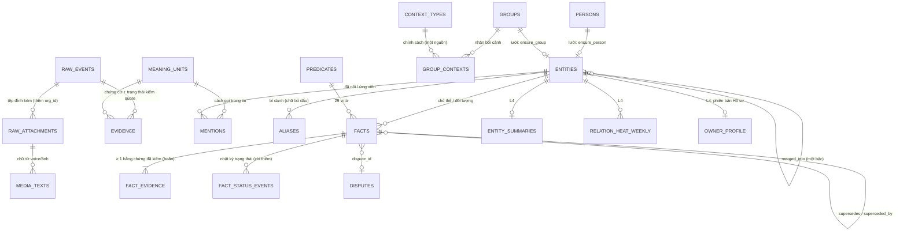

# Lõi trí nhớ 5 lớp — ERD ngắn (v0.1.76, gói L1)

Nguồn: spec Bước 1 r6.1 §4A (cổng ⑤ gọn). Migration `db/sql/0043_v0176_tri_nho.sql`; mã `apps/api/gh/biz/mem/`; hợp đồng đầu ra
bộ não `apps/api/gh/refinery/brain_contract.py` (`brain-out/1`). Chỉ L0 (`raw.events`) là sự thật gốc; L1–L3 có `extractor_version`
nên chạy lại (replay) được; L4 dựng lại được.

## Luật cần nhớ

- **Hai thời gian.** `valid_from/valid_to` = lúc sự việc xảy ra (neo vào giờ GỬI tin); `recorded_at`/`closed_recorded_at` = lúc hệ thống biết.
  Không sửa nội dung; chỉ `valid_to`, `status`, `superseded_by`, `dispute_id`, `confirmed_*`, `evidence_n`, `closed_recorded_at` đổi được
  (trigger `mem.facts_guard`; mỗi đổi ghi `mem.fact_status_events`). `DELETE` chỉ khi `gh.mem_erase = 'on'` (đường quên người).
- **Không chồng khoảng.** `EXCLUDE USING gist` trên (chủ thể, vị từ, khoảng hiệu lực) cho dòng đơn trị `asserted`/`owner_confirmed`
  — kể cả dòng đã đóng `valid_to`. Đóng theo thời gian sự việc giữ `asserted`; `superseded` chỉ cho sửa theo thời gian ghi nhận.
- **Bằng chứng hoãn.** `CONSTRAINT TRIGGER mem_facts_need_evidence` (DEFERRABLE INITIALLY DEFERRED): `asserted`/`owner_confirmed`/`disputed`
  cần ≥ 1 bằng chứng `verified` hoặc `owner_edit`; `proposed` cần ≥ 1 bất kỳ. `assert_fact` gọi `SET CONSTRAINTS … IMMEDIATE`
  trong savepoint để bắt lỗi ngay.
- **Một nơi ghi.** `facts.assert_fact` theo thứ tự cố định: chuẩn hoá thực thể → khoá tư vấn → idempotent → (đơn trị) tìm `prev/next` →
  quyết định rồi mới ghi (UPDATE `prev` trước, INSERT sau) → bằng chứng → kiểm hoãn. `exclusion_violation` là lỗi (đếm
  `fact_write_conflict`, vào `refinery.fact_retry`), không đổi thành `disputed`.
- **`payment_account`** (`auto_supersede = false`): mọi đổi giá trị, kể cả chính chủ tài khoản, ra `disputed` + `mem.disputes`
  (`rui_ro_lua_dao`); chỉ Sếp đóng được (Console + PIN).
- **Gộp người** = đặt `mem.entities.merged_into` (chuyển hướng, không dời dữ liệu); nén đường đi nên `coalesce(merged_into, id)` một bậc luôn
  đủ; sau gộp, sự thật đơn trị trái nhau giữa hai bên ra `disputed`.
- **Quên người** (`forget.erase_entity`, chỉ từ Console + PIN): xoá thật bí danh, nhắc tới, tóm tắt, độ nóng, bằng chứng, nhật ký trạng thái
  và mọi sự thật có người đó làm chủ thể/đối tượng; thực thể giữ lại nhưng ẩn danh. `raw.events` không đụng.
- **Chính sách bối cảnh** (`mem.context_types.policy`, `contexts.policy/render_for_prompt`): nhóm chưa xác nhận dùng hàng "chưa xác nhận"
  (đủ 6 cổng, không chấm điểm người, không cơ hội ngoài cổng). Chính sách chỉ hạ hoặc tắt, không bao giờ nâng.
- **Quên người xoá theo bí danh.** Mention chưa nối (`candidate`/`unresolved`) có cách gọi trùng bí danh của người bị quên bị xoá; có thể xoá
  cả mention trùng tên của một người KHÁC — chấp nhận, nghiêng về riêng tư.
- **Khoá master và digest STK.** `payment_account.digest` = HMAC bằng khoá con của `GH_MASTER_KEY` (`facts.payment_digest`). Mất hoặc đổi
  `GH_MASTER_KEY` làm mọi digest STK cũ lệch ⇒ STK cũ gặp lại sinh tranh chấp `stk_moi` hàng loạt; ghi vào quy trình backup/xoay khoá.
- **Backup/restore.** `mem.fold` ghi đủ schema (`public.unaccent` + từ điển `'public.unaccent'::regdictionary`) để cột sinh
  `mem.aliases.alias_folded` và chỉ mục biểu thức dựng lại được khi `pg_restore` đặt `search_path` rỗng (có test vòng backup → restore).

## Hợp đồng chữ ký hàm (L2–L6 chỉ đọc)

`entities.ensure_person/ensure_group/owner`, `entities.canonical` · `aliases.add/resolve` · `mentions.link` ·
`facts.assert_fact(db, FactIn) -> Fact` (+ `assert_facts`, `correct`, `at`, `retire_stale_replay`, `reconcile_entity`) ·
`disputes.open/list/resolve` · `contexts.policy(db, org, thread_key)` / `contexts.render_for_prompt(policy)` ·
`profile_read.snapshot(db, org)` (chỉ `owner_confirmed`) · `retrieve.pack(db, org, thread_key, events)` ·
`forget.erase_entity(db, org, person_id)` · `brain_contract.BrainOut` + `json_schema()`.
